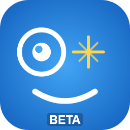

<h1 align="center">JITAI Wizard · Android Companion Suite</h1>

<p align="center">
  
</p>

<p align="center">
  <i>A research-grade intervention delivery system for Wear OS and Android.</i><br/>
  <i>Project for the Bachelor of Science at the University of Siegen.</i>
</p>

<p align="center">
  <a href="https://github.com/RBurchard/JITAI-WizardAndroid/releases/latest"></a>
  
  
  
  
  
</p>

<p align="center">
  <b>Latest release:</b> <a href="https://github.com/RBurchard/JITAI-WizardAndroid/releases/latest">v2.1.1</a> &middot; signed Phone APK + Wear OS APK &middot;
  pairs with the <a href="https://github.com/RBurchard/JITAI-WizardControlStation">Control Station</a>
</p>

> [!NOTE]
> This README is kept up to date by an LLM under Sebastian's control. Details may be inaccurate until a full manual review. If you find something wrong, please correct it or mark it.
>
> **Maintenance:** this file is the authoritative reference for the project. If you change a screen, a protocol path, a port number, a sensor, a game mechanic or a build target, update the matching section here before merging. If something new belongs in here, add it.

---

## Table of Contents

1. [Overview](#overview)
2. [Download & Install](#download--install)
3. [Release History](#release-history)
4. [System Architecture](#system-architecture)
5. [Requirements](#requirements)
6. [Building from Source](#building-from-source)
7. [Phone Application](#phone-application)
8. [Odi, the Character](#odi-the-character)
9. [Wear OS Application](#wear-os-application)
10. [Interventions, Games and Notifications](#interventions-games-and-notifications)
11. [Communication Protocol Reference](#communication-protocol-reference)
12. [Logging and Data Export](#logging-and-data-export)
13. [Known Limitations and Notes](#known-limitations-and-notes)

---

## Overview

JITAI Wizard is a platform for delivering **Just-In-Time Adaptive Interventions** (JITAIs) in behavioural research studies. An intervention is a prompt, task or micro-game triggered at a precise moment, typically in response to a physiological or behavioural signal, with the goal of reinforcing or redirecting a participant's behaviour. The current studies use it as a Wizard-of-Oz system around hand washing.

The system has three tiers:

| Tier | Runs on | Role |
|------|---------|------|
| **Control Station** | Windows PC | The researcher designs experiments, discovers devices, sends interventions and records everything. Lives in its own repository: [JITAI-WizardControlStation](https://github.com/RBurchard/JITAI-WizardControlStation). |
| **Phone app** (`mobile`) | Android phone | The bridge. Hosts an HTTP/WebSocket server for the Control Station, runs the experiment engine, relays interventions to the watch and streams the watch's sensor data upstream. Can also run a study on its own. |
| **Watch app** (`wear`) | Wear OS watch | Collects biometric and motion data, shows interventions to the participant and hosts the micro-games. |

Both Android apps share the application ID `com.BWPStudio.JITAIWizard`, which the Wearable Data Layer needs to link the phone and watch apps.

---

## Download & Install

> [!TIP]
> Just want to run it? Grab the signed APKs from the [**latest release**](https://github.com/RBurchard/JITAI-WizardAndroid/releases/latest). No build tools required.

Every release ships both APKs signed with the **same key**, so the Wearable Data Layer handshake works out of the box, and each release installs over the previous one as an update. Always install the phone and watch builds **from the same release**.

| File | Install on | Minimum OS |
|------|-----------|------------|
| `JITAI-Wizard-Phone-v2.1.1.apk` | Android phone | Android 10 (API 29) |
| `JITAI-Wizard-Watch-v2.1.1.apk` | Wear OS watch | Wear OS 4.0 (API 33) |

1. On both devices, allow installs from your browser or file manager (**Settings → Apps → Install unknown apps**).
2. Install the **Phone** APK on the Android phone.
3. Install the **Watch** APK on the Wear OS watch (via the watch's browser, ADB, or a file-push app).
4. Make sure the phone and watch are paired, signed in to the **same Google account**, and have Bluetooth on.
5. Open the phone app. The watch pairs automatically over the Wearable Data Layer.

**Also required for a full study setup:** the Windows Control Station, from the [JITAI-WizardControlStation releases](https://github.com/RBurchard/JITAI-WizardControlStation/releases/latest). The phone can also run an experiment and export a CSV without it.

Prefer to build it yourself? See [Building from Source](#building-from-source).

---

## Release History

Both repositories are released together under the same version number.

| Version | Highlights |
|---------|-----------|
| **v2.1.1** | First 2.x release on `main`. Fixes reordering events in the phone's schedule editor (dragging an event jittered or moved its neighbour). |
| v2.1.0-beta | German variants of the four bundled experiments, mini-game difficulty pinned to medium, long watch messages shown in full, watch idle profile verified on hardware, **Wake watch** button. Used for the follow-up test. |
| v2.0.0-beta | Accessible mini-game rework, difficulty stored on the experiment, dark theme, Wizard view rework, English/German/Dutch UI. |
| v1.2.0 | Phone-side CSV export, engine-status layout fix. Used for the first study run. |
| v1.1.0-beta, v1.0.0-beta | First public builds. |

Full notes for each version are on the [Releases page](https://github.com/RBurchard/JITAI-WizardAndroid/releases).

---

## System Architecture

```
+------------------+           UDP 5280 (discovery)           +-------------------+
|  Control Station | <--------------------------------------> |   Android Phone   |
|  Windows / .NET  |           HTTP 8080 (control)            |   mobile module   |
|  Avalonia UI     | <--------------------------------------> |   Ktor server     |
+------------------+     WS 8080 /stream (data), /events      +-------------------+
                                                                        |
                                                               Wearable Data Layer
                                                              (Google Play Services)
                                                                        |
                                                              +-----------------+
                                                              |  Wear OS Watch  |
                                                              |  wear module    |
                                                              |  Sensor service |
                                                              +-----------------+
```

- **The Control Station** discovers phones on the local network by listening for UDP beacons (or over USB debugging). Once connected, it sends commands over HTTP and receives the watch's sensor stream and the experiment's event stream over two WebSockets.
- **The phone** never initiates contact with the Control Station. It broadcasts its presence and waits. Commands from the Control Station become Wearable Data Layer messages to the watch, and data from the watch is forwarded to every connected WebSocket client.
- **The watch** runs a foreground sensor service and sends batched sensor snapshots to the phone every 100 ms while a session is active (once a minute while idle; see [Power profiles](#power-profiles)). When an intervention arrives, it shows it full screen and optionally starts a micro-game.

---

## Requirements

### Hardware

| Component | Minimum | Recommended |
|-----------|---------|-------------|
| Android phone | Android 10 (API 29) | Android 15 |
| Wear OS watch | Wear OS 4.0 (API 33) | Wear OS 6.0+ (developed on a Pixel Watch 4) |

The phone and watch must be paired and signed in to the same Google account, with Bluetooth on: the Wearable Data Layer depends on it. For Control Station connectivity, the phone must be on the same Wi-Fi network as the PC (or attached by USB with USB debugging on). The watch only talks to the phone and needs no network access of its own.

### Software

| Tool | Notes |
|------|-------|
| Android Studio | Recommended. VS Code can build too, but then you need a JDK installed yourself. |
| JDK 17 or newer | Android Studio's bundled JDK 21 works. The code compiles to Java 11 bytecode. |
| Gradle / AGP | Wrapper included. Plugin and library versions are in `gradle/libs.versions.toml` (AGP 9.2, Kotlin 2.2, Ktor 3.1). |

---

## Building from Source

1. Clone the repository:

   ```bash
   git clone https://github.com/RBurchard/JITAI-WizardAndroid.git
   ```

2. Open the project root in Android Studio and wait for the Gradle sync. All dependencies download automatically.
3. **Phone:** run the `mobile` configuration on a connected Android device (API 29+).
4. **Watch:** run the `wear` configuration on a connected Wear OS device (API 33+), over Bluetooth or Wi-Fi ADB.
5. Install both apps from the same build so they share a signing key. Otherwise the Data Layer capability handshake fails.

> [!WARNING]
> Emulated devices in Android Studio may not complete the phone–watch handshake. Use physical devices to test the full communication flow.

Command-line build of both release APKs (requires a `keystore.properties`, which is not in the repository):

```bash
./gradlew :mobile:assembleRelease :wear:assembleRelease
```

Unit tests: `./gradlew :mobile:testDebugUnitTest`.

### Project Structure

| Module | Contents |
|--------|----------|
| `convention` | Code shared by both apps: the wire models (`Intervention`, `Experiment`, `WatchDataBatch`, `MicrogameSettings`, …), every Data Layer and HTTP path (`Protocol.kt`), and the language picker. |
| `mobile` | The phone app: Ktor server, UDP beacon, experiment engine, triggers, logging, Compose UI. |
| `wear` | The watch app: sensor service, power policy, intervention screen, micro-games, tile and complication. |

### Build Configuration

| Setting | Phone (`mobile`) | Watch (`wear`) |
|---------|------------------|----------------|
| applicationId | `com.BWPStudio.JITAIWizard` | `com.BWPStudio.JITAIWizard` |
| compileSdk / targetSdk | 36 / 36 | 36 / 36 |
| minSdk | 29 | 33 |
| Java bytecode | 11 | 11 |
| Compose | Enabled | Enabled |
| Minification (R8) | Off | Off |

The application ID is set in both `mobile/build.gradle.kts` and `wear/build.gradle.kts`. Never change one without the other.

---

## Phone Application

The phone app is the hub of the system. It stays in the foreground and hosts the services for both directions of communication.

### What Starts on Launch

The `JITAIWizardApp` application class starts, in order:

- **ExperimentLogger** writes experiment events to TSV files on the device.
- **WearSyncLogger** records every Wearable Data Layer send and receive.
- **KtorServer** serves HTTP and WebSockets on port 8080.
- **UdpBeacon** broadcasts a discovery packet on UDP port 5280 every 5 seconds.

### Screens

The whole app uses a dark theme. Phone and watch each have their own language setting (English, German, Dutch, or the system default).

#### User View (default screen)

What a participant or facilitator sees during a session:

- **Odi**, the animated mascot (see [Odi, the Character](#odi-the-character)).
- **Stats card**: current BPM, last reaction time in ms, and the watch connection (filled circle = connected). **Long-press it for 3 seconds** to unlock the Wizard view.
- **Session timer**: elapsed time since the app started.
- **Last action**: the most recent response from the watch, such as the button a participant pressed.
- A **settings** button that opens the Settings screen.

#### Wizard View (researcher access)

Unlocked from the User View as above. On top sits a warning strip that marks this as the researcher view, and a **watch status card** with live heart rate, **Ping** and **Wake 5 min**, plus quick-fire buttons for manual triggers. A segmented switch selects one of two tabs:

**Control** composes and sends a single intervention by hand:

- Message text (default "Stop!")
- Display type: Text, Timer or Yes/No
- Micro-game: None, Lock Picking, Simon Says, Trivia or Stand Still
- Duration slider, 1 to 60 seconds
- One send button per notification type (see [Notification Types](#notification-types))
- A cancel button that stops a running intervention on the watch (asks for confirmation)
- A **Mini-game difficulty** card that opens the difficulty editor (also reachable from **Settings**). See [Difficulty Settings](#difficulty-settings).

**Experiment** designs and runs a structured schedule:

- An ordered list of **events**, each with a duration, an event kind and an optional intervention. Event kinds:

  | Kind | Behaviour |
  |------|-----------|
  | Timed | Runs for its duration, then advances (in Auto mode). |
  | Random Wait | Waits a random time between a minimum and a maximum. |
  | Wait for Action | Waits for a participant response with a matching action ID. In Auto mode it gives up after the event's duration (60 s if none is set). |
  | Wait for Trigger | Waits until a given trigger fires, with the same timeout. |
  | Wait for Previous | Waits for any response to the intervention, then (in Auto mode) for the event's duration. Never times out. |

- **Triggers** that watch the live sensor stream on the phone: *Rapid Movement* (acceleration above a threshold within a window), *Repeating Movement* (sustained motion between two frequencies, e.g. 1 to 4 Hz for 3 s), *Heart Rate* (above or below a BPM for a sustained time) and *Manual* (fired by hand or from the Control Station).
- Drag-to-reorder in edit mode.
- **Run controls:** Start, **Auto** (the engine steps through the schedule by itself), Pause, Stop, Previous and Next. Elapsed time per event is shown, and **Send intervention** fires the current event's intervention once.
- Participant ID and experiment name fields.
- Save and load named schedules on the phone. The Load dialog has **Import from phone…** (pick an experiment JSON, which becomes a new slot), and the Save dialog has **Export to file (Downloads)**, which writes the schedule as `.json` to `Downloads/JITAI_WIZARD_experiments/`.
- Optional TSV logs and a standalone CSV export (the **Save Logs** toggle). See [Logging and Data Export](#logging-and-data-export).

**Bundled experiments.** Eight templates are ready in the Load dialog: the English default (**Default - Hand-washing Study**), **Distraction Combo - No Games**, **Alternate Microgame - Lock Picking** and **Stand Still Only**, plus a German variant of each (slot names start with **DE -**, e.g. **DE - Handhygiene - Nur Stillstehen**). They mirror the Control Station's `Assets/experiment_*.json`. Each is a single hand-wash cycle (Wizard-of-Oz, no tutorial) with a clearly marked HW-timer start/stop, and each pins the mini-game difficulty to medium (Simon Says 3/5 with 4 rounds, Lock Picking 3/5, a mistake stuns). Only the text people read is translated. Event and intervention IDs are the same in both languages, so English and German runs line up in the logs.

> [!NOTE]
> Templates are seeded once and never overwritten. Deleting one does not bring it back on the next launch, and a template seeded by an older version is not refreshed. Import the updated file to replace it.

### HTTP Server

The Ktor server listens on port 8080 for the Control Station (or any HTTP client on the network).

| Method | Path | Purpose |
|--------|------|---------|
| GET | `/status` | Watch connection state, session ID, uptime in seconds, last BPM |
| GET | `/data` | Session ID, participant label, last reaction time (ms), last heart rate, last action |
| POST | `/trigger` | Accepts an intervention request (JSON), sends it to the watch, returns the intervention ID |
| POST | `/trigger/fire` | Fires a manual trigger by trigger ID |
| POST | `/watch/wake` | Holds the watch at full sensor rate for `{"minutes": n}` (default 5, max 60) without starting a run; relayed as `/power/wake` |
| GET | `/participant` | The current participant info |
| POST | `/participant` | Sets participant info (id, sessionId, label, deviceIp). The Control Station calls this before a session so watch data is linked to the right session row |
| GET | `/experiment` | The current experiment JSON, with an `X-Experiment-Etag` header for conflict detection |
| PUT | `/experiment` | Replaces the experiment; returns 409 if the client's ETag is stale |
| POST | `/experiment/control` | Run command: `start`, `auto`, `pause`, `stop`, `next` or `prev` |
| GET | `/logs?since={id}&limit={n}` | A page of session log entries after `since`; the Control Station's polling fallback when `/events` is down |
| GET | `/trivia` | The current trivia question bank |
| POST | `/trivia` | Replaces the trivia question bank |
| WS | `/stream` | `WatchDataBatch` JSON in real time as it arrives from the watch. The Control Station stores every batch in `watch_data` |
| WS | `/events` | `WsEnvelope` JSON for experiment state changes, log entries, trigger fires and run/intervention lifecycle events. The Control Station fills `session_logs`, `experiment_runs` and `distraction_runs` from it |

### UDP Beacon

Every 5 seconds the phone broadcasts to the local subnet on port 5280:

```json
{"app": "JITAIWizard", "port": 8080, "name": "<device model>"}
```

The Control Station listens on this port to fill its device list.

### Wearable Data Layer (phone side)

**Outgoing (phone to watch):**

- Interventions go out via `MessageClient` on `/intervention/trigger` as JSON.
- `/ping` checks connectivity; the watch answers on `/pong`.
- `/game/settings` pushes the mini-game difficulty; the watch confirms what it stored on `/game/settings/ack`.
- `/session/state` carries `"1"` while a run is in progress and `"0"` otherwise. It repeats every minute during a run so the watch can expire a stale claim.
- `/power/wake` carries a duration in ms and keeps the watch at full rate that long without a run. Sent by **Wake 5 min** and by the Control Station via `POST /watch/wake`.
- `/exit` closes any open intervention or game screen on the watch.
- The watch node is found via the capability `jitai_wizard_wear`, with a fallback to any connected node on first run.

**Incoming (watch to phone)**, handled by `WearMessageListener`:

| Path | Purpose |
|------|---------|
| `/intervention/response` | The participant's response (choice or game result); updates reaction time |
| `/watch/data` | A `WatchDataBatch` of sensor snapshots |
| `/pong` | Reply to a ping; confirms the watch is reachable |
| `/game/settings/ack` | The mini-game settings the watch actually stored |

Sensor batches go to the `WatchDataRelay` shared flow, which feeds the WebSocket stream, the trigger engine and the User View at the same time.

---

## Odi, the Character

Odi is the animated mascot on both phone and watch. It is drawn entirely in code with the Jetpack Compose Canvas. There is no image file behind it, which keeps it smooooth.

### Design

Three geometric shapes:

- **Left eye:** a full circle outline with a white pupil. The "O".
- **Right eye:** a D-shape, flat on the left and curved on the right. The "D".
- **Mouth:** a C-shaped arc at the bottom of the face. The "C".

Together they spell "Odi" (if you squint reeeaaallly hard; Odi, OCD). The palette is two blues: a deep primary `#1565C0` for outlines and a lighter accent `#42A5F5` for highlights.

### Moods and Dialogue

The phone picks Odi's line from the current mood. Lines are localized; English shown here, 32 characters at most.

| Mood | Look | Example lines |
|------|------|---------------|
| IDLE | Calm breathing, random blinks, glancing around | "Monitoring...", "Stay sharp!", "You've got this." |
| TALKING | Mouth moves while delivering a message | "Focus... you can do this!", "Check your phone." |
| THINKING | Eyes drift up, thought dots bubble | "Analyzing...", "Hmm...", "Crunching the data..." |
| CELEBRATING | Bouncing, beaming, confetti and sparkles | "You resisted!", "Mind over matter!", "Outstanding!" |
| HAPPY | A warm, content smile | "Nice and steady.", "Great pace!" |
| SURPRISED | Wide eyes, small round mouth | "Whoa!", "Heads up!" |
| SLEEPING | Eyes shut, drifting "z"s | "Zzz...", "Just a little nap." |
| CONCERNED | A worried frown (e.g. heart-rate spike, lost sensors) | "Easy now...", "Take a breath." |

The lines are still mostly placeholders, so feel free to add to them or adjust them (`mobile/src/main/res/values/strings_userview.xml`).

**Where Odi appears:** the phone's User View (reacting to the session), the watch's main screen (with a BPM badge), the Positive Feedback screen (always celebrating), and the mini-game tutorials and Stand Still game on the watch.

---

## Wear OS Application

The watch app needs Wear OS 4.0 (API 33) or later. It is not standalone: it needs the phone app running and the devices paired. Standalone use is not planned while the focus is Wizard-of-Oz research.

### Main Screen

- Odi in the centre of the round display.
- A BPM badge on the left edge, pulsing while the sensor service is active.
- A status line below Odi ("Odi is watching", "Hi, I'm Odi", "Waiting for sensors...", …).
- A permission prompt if the health permissions are not granted yet.
- An entry to the watch **Settings**.

### Watch Settings

- **Language:** system default, English, German or Dutch.
- **Mini-game difficulty**, editable on the wrist. The next push from the phone wins, which keeps a session consistent with the schedule loaded for it.
- **Practice:** free-play rounds of each game. Practice rounds send nothing to the phone and produce no study data, so a participant can try a game while the researcher is still setting up.
- **Force End:** shuts the sensor service down. It stays down until the phone actively asks for the watch (an intervention, a ping, a wake request or a running session).

### Permission Flow

**Mandatory** (the service will not start without these): `ACTIVITY_RECOGNITION`, `POST_NOTIFICATIONS`.

**Sensor** (at least one, for heart rate): `health.READ_HEART_RATE`, `BODY_SENSORS`.

`WatchDataService` starts automatically once the mandatory permissions and at least one sensor permission are granted.

### WatchDataService

A foreground health service that collects sensor data. Heart rate uses two sources at once for compatibility, and whichever reports first wins for that moment:

- **Primary:** Android Health Services (`MeasureClient`, `DataType.HEART_RATE_BPM`)
- **Fallback:** the legacy `SensorManager` with `Sensor.TYPE_HEART_RATE`

During a session, motion is decimated to about 50 Hz and every 100 ms the buffered readings are packed into a `WatchDataBatch` and sent to the phone.

#### Power profiles

`WatchPowerPolicy` picks one of two profiles:

- **Active** is the study configuration described above and runs during a session.
- **Idle** keeps only the step counter (batched in the sensor hub for a minute at a time), takes heart rate from Health Services passive monitoring (or a 12 s measurement every 3 minutes on watches without it), and sends one snapshot a minute so the phone still sees a live watch. Nothing in the idle profile wakes the processor on a schedule. Measured on a Pixel Watch 4 at about 0.26 mAh over 20 minutes.

The watch drops to idle only when **all** of these hold:

- the phone has not claimed a running session (`/session/state` = `"1"`, which expires after 3 minutes without a refresh),
- no wake request is outstanding (`/power/wake`, 5 to 60 minutes),
- no screen of the app is open,
- and nothing has touched the watch for 5 minutes (any phone message or app screen counts).

The watch never decides "no session" on its own, because a schedule can legitimately sit on a fifteen-minute wait.

**Wake 5 min** (phone watch card, Control Station connection card) is for setup: live heart rate and motion on the Control Station while fitting the watch, without a run. It only delays the idle timer. A run started inside the window keeps the watch awake for as long as it runs, so there is nothing to cancel.

### Sensors Collected

| Sensor | Source | Sampling | Data fields |
|--------|--------|----------|-------------|
| Heart rate | Health Services + SensorManager | Event-driven | `heartRate` (BPM) |
| Accelerometer | SensorManager | GAME, decimated to ~50 Hz | `accelX`, `accelY`, `accelZ` |
| Gyroscope | SensorManager | GAME, decimated to ~50 Hz | `gyroX`, `gyroY`, `gyroZ` |
| Rotation vector | SensorManager | GAME | `rotationX`, `Y`, `Z`, `W` |
| Step counter | SensorManager | NORMAL | `stepCount` |
| Barometer | SensorManager | NORMAL | `barometer` (hPa) |
| Light | SensorManager | NORMAL | `light` (lux) |

Each `WatchDataSnapshot` carries a timestamp, all fields above, and a `sessionId`.

### Wearable Data Layer (watch side)

**Incoming (phone to watch)**, handled by `WearMessageListener`:

| Path | Action |
|------|--------|
| `/intervention/trigger` | Parses the intervention JSON and opens the matching screen or game |
| `/phone/task` | Shows a "check your phone" prompt |
| `/ping` | Answers immediately with `/pong` |
| `/session/state` | `"1"` or `"0"`: whether the phone has a run in progress (for the power profile) |
| `/power/wake` | Duration in ms: hold the active profile that long without a run |
| `/game/settings` | Applies pushed mini-game settings and echoes the stored values on `/game/settings/ack` |
| `/exit` | Closes any open intervention or game screen |

`WearMessageListener` also restarts `WatchDataService` when the phone actively wants the watch: an intervention, a phone task, a ping, a wake request, or `/session/state` = `"1"`. Housekeeping messages (settings pushes, `/exit`, "no session") do not, so a watch shut down with **Force End** stays down until the phone asks for it.

**Outgoing (watch to phone):** `/intervention/response`, `/watch/data`, `/pong`, `/game/settings/ack` (see the phone-side table above).

### InterventionActivity

Shown when an intervention arrives. Three modes:

- **Text:** a message and an OK button.
- **Yes/No:** a question and two buttons; the choice goes back to the phone.
- **Timer:** a circular countdown arc going from green to yellow to red, with an outer arc for the whole session. OK can be pressed at any time.

All modes support vibration patterns and optional looping sounds, and keep the screen on. Without a response, the screen closes itself after the configured duration. Long messages are never clipped: the text shrinks to a readable size (never below 12 sp), then wraps and scrolls by touch or crown, with a fade and an arrow on the edge that has more text.

### Micro-games

Started by `WearMessageListener` when an intervention names a game. All games extend `MicrogameActivity`, which provides vibration, messaging, permission checks and the tutorial. A tutorial **asks before it teaches**: Odi first asks whether you know the game, and the instructions only appear if you say no. The games were reworked in 2.0 for accessibility, so none of them depends on colour vision alone, and a slip costs progress instead of the whole game.

| Game | How it plays |
|------|--------------|
| **Stand Still** | Hold the wrist still for 10 seconds in a row. Motion is the smoothed accelerometer magnitude (`sqrt(x²+y²+z²) - 9.8`) against a 0.5 m/s² threshold; going over resets the timer. Odi sways with the live reading and a steadiness bar shows how much headroom is left, so a wobble is visible before it costs anything. |
| **Trivia** | A multiple-choice question with four answers, taken from the intervention or from a built-in fallback. Afterwards it marks which answer was picked and which was right, and holds the result long enough to read it. |
| **Simon Says** | Repeat a growing sequence. Each pad is a full quarter of the watch face with its own shape (star, square, circle, heart) and its own vibration rhythm, so a sequence can be read as "heart, heart, square" or felt as "short, short, long". A mistake replays the same round; rounds already cleared are kept. Default 4 rounds. |
| **Lock Picking** | A three-stage heist. **1. Creep the corridor:** hold the wrist steady and the thief tiptoes between two laser grids; wobbling drains progress instead of resetting it. **2. Dodge the guillotines:** a circular swipe moves him along a corridor of beams that telegraph before they drop; walking into one stuns him for a second. **3. Crack the safe:** turn the dial with the crown (or a drag) and feel for the notch, as the vibration ticks harder the closer you get; park on it for a second, three times. |

Game screens close themselves after 5 minutes without being finished, so a game nobody plays cannot keep the display on until the battery is flat.

### Positive Feedback Screen

Shown after a successful game: green background, Odi celebrating, and a random message ("You resisted!", "Excellent control!", "Mind over matter!", "Strong work!", "Keep it up!", "Well done!", "You did it!"). Closes after 3 seconds.

### Complication and Tile

- `MainComplicationService` provides a SHORT_TEXT complication with the day of the week (Mon, Tue, …), updated hourly.
- `MainTileService` provides a tile. It is still a placeholder ("Hello, Tile!").

---

## Interventions, Games and Notifications

### Display Types

| Type | Description |
|------|-------------|
| Text | A message with a single OK button |
| Yes/No | A question with Yes and No buttons |
| Timer | A circular countdown with an OK button |

### Micro-game Types

| Wire value | Name | Description |
|------------|------|-------------|
| *(null)* | None | Just the intervention screen |
| `STAND_STILL` | Stand Still | Accelerometer stillness challenge |
| `TRIVIA` | Trivia | Multiple-choice question |
| `SIMON_SAYS` | Simon Says | Sequence memory game |
| `LOCK_PICKING` | Lock Picking | Three-stage heist |

### Difficulty Settings

Mini-game difficulty is stored **on the experiment**, so loading a schedule sets the watch up for that condition. Changes are pushed to the watch, which confirms what it stored. Every change is written to the session log and exported in the CSV's `MINIGAME SETTINGS` section.

| Setting | Range | Default | Effect |
|---------|-------|---------|--------|
| Simon speed | 1 to 5 | 2 | Shortens the show phase (flashes from 800 ms down to 300 ms). The input window is never shortened. |
| Simon rounds | 2 to 8 | 4 | Rounds needed to win. |
| Lock difficulty | 1 to 5 | 2 | Less movement tolerated and a longer hold in stage 1 (4 to 10 s); a longer corridor with more beams in stage 2 (difficulty + 1 beams). |
| Mistake costs | Stun, Push back, Restart stage | Stun | What a lock-picking mistake costs. |

The bundled experiments pin Simon 3/5 with 4 rounds, Lock 3/5, and Stun.

### Notification Types

| Wire value | Phone button | Description |
|------------|--------------|-------------|
| `VIBRATION1` | Vib Short | Single short vibration |
| `VIBRATION2` | Vib Long | Single long vibration |
| `SOUND` | Sound Short / Sound Long | Notification tone (both buttons send this value) |
| `VIBRATION_SOUND` | Vib + Sound Short | Short vibration and tone together |
| `VIBRATION_SOUND2` | Vib + Sound Long | Long vibration and tone together |
| `ANNOY_VIB` | Perma Vibration | Repeating vibration until dismissed |
| `ANNOY_SOUND` | Perma Sound | Looping tone until dismissed |
| `ANNOY_VIBRATION_SOUND` | Perma Both | Repeating vibration and looping tone |
| `CANCEL` | Cancel | Stops the running intervention |

---

## Communication Protocol Reference

All paths are defined once in `convention/src/main/java/com/example/jitaicompanion/convention/Protocol.kt`.

### Wearable Data Layer Message Paths

| Direction | Path | Content |
|-----------|------|---------|
| Phone → Watch | `/intervention/trigger` | Intervention JSON |
| Phone → Watch | `/phone/task` | Task description string |
| Phone → Watch | `/ping` | Timestamp string |
| Phone → Watch | `/game/settings` | `MicrogameSettings` JSON |
| Phone → Watch | `/session/state` | `"1"` (run in progress) or `"0"` |
| Phone → Watch | `/power/wake` | Duration in ms (decimal string) |
| Phone → Watch | `/exit` | Empty |
| Watch → Phone | `/intervention/response` | Participant response or game result |
| Watch → Phone | `/watch/data` | `WatchDataBatch` JSON |
| Watch → Phone | `/pong` | Timestamp echoed from `/ping` |
| Watch → Phone | `/game/settings/ack` | The `MicrogameSettings` the watch stored |

### Capability Names

| Capability | Declared by |
|------------|-------------|
| `jitai_wizard_phone` | Phone app (the watch uses it to find the phone) |
| `jitai_wizard_wear` | Watch app (the phone uses it to find the watch) |

### HTTP, WebSocket and UDP

See [HTTP Server](#http-server) and [UDP Beacon](#udp-beacon) above. For how the Control Station calls these endpoints, see the [Control Station README](https://github.com/RBurchard/JITAI-WizardControlStation#communication-protocol-reference).

---

## Logging and Data Export

### Where sensor data is stored

Raw sensor data (heart rate, accelerometer, gyroscope, rotation, barometer, light, steps) streams to the Control Station over the `/stream` WebSocket and is stored in its SQLite database (`%APPDATA%\OcdWizard\data.db`, table `watch_data`). Batches that arrive while no Control Station is connected are not stored there (the in-memory relay holds at most 64 batches).

To get the sensor data as CSV, either export it from the Control Station, **or** enable the phone-side CSV export below to capture an equivalent file with only the phone present.

### Phone-Side CSV Export (1:1 with the Control Station)

With **Save Logs** on, starting a manual run on the Experiment tab starts capturing the live watch stream. Stopping or finishing the run writes the file to `Downloads/JITAI_WIZARD_csv/` (`{experiment}_{participant}_{timestamp}.csv`) and shows the path in a toast. The file follows the Control Station's export layout section by section:

| Section | Source on the phone | Fidelity |
|---------|---------------------|----------|
| `=== SESSION ===` | `name` and `participants` = the participant/session name (`participantId`); `notes` = the in-run 📝 Note entries | Full |
| `=== MINIGAME SETTINGS ===` | One `change` row per difficulty change logged during the run, plus a `final` row with the settings in force at export | Full |
| `=== WATCH DATA ===` | The live `WatchDataRelay` stream | Full, every snapshot |
| `=== SESSION LOGS ===` | `SessionLogStore` ring buffer | Full (last 2000 entries) |
| `=== INTERVENTIONS ===` | Built from the session-log stream | Timing, response and reaction time faithful; `game_type` and `notification_type` left blank |
| `=== EXPERIMENT RUNS ===` | Run ID and timing | One row for the run |
| `=== DISTRACTION RUNS ===` | Built from intervention send/response pairs | Best effort |

Sensor rows are written as one buffered append per watch batch, so a full-rate stream costs about 10 disk flushes per second. Written by `PhoneCsvLogger`. It covers the manual Start/Stop/Finish flow; engine **Auto** runs are not captured yet.

### Phone-Side Logs

> [!NOTE]
> Log destinations, style and format are not final.

**Experiment logs** are written by `ExperimentLogger` to `Downloads/JITAI_WIZARD_logs/` as `{experimentName}_log_{participantName}_{timestamp}.tsv`. They are also forwarded to the Control Station over `/events` and stored in its `session_logs` table.

| Column | Description |
|--------|-------------|
| timestamp | Unix time in ms |
| participant | Participant label |
| event_type | Event type, e.g. `intervention_sent`, `response_received` |
| value | Numeric value for the event |
| details | Free-text detail |

**Wear sync log** is written by `WearSyncLogger` to app-internal storage as `wear_sync_logs.tsv`. Useful for debugging phone–watch communication.

| Column | Description |
|--------|-------------|
| timestamp | Unix time in ms |
| event_type | `wear_send`, `wear_receive` or `wear_connection` |
| value | Numeric value (e.g. BPM, reaction time) |
| path | Data Layer message path |
| node_id | ID of the remote node |
| payload_bytes | Payload size |
| details | Free-text detail |

---

## Known Limitations and Notes

- The phone must be on the same Wi-Fi subnet as the Control Station PC (or attached over USB). The HTTP server on port 8080 is **unencrypted and unauthenticated**. Do not expose it on a public network. For realsies.
- Wear OS 4.0 (API 33) is the minimum for the watch. Android 15 and Wear OS 6.0+ are recommended.
- **Phone tasks** (Draw, Camera) can be chosen for an event and travel with the intervention, but nothing launches the phone's `DrawActivity` or `CameraActivity` yet, and the phone does not send `/phone/task`.
- Each game declares a nominal timeout, but only the 5-minute abandon timeout is enforced, so a real playthrough is never cut short.
- `BODY_SENSORS_BACKGROUND` is commented out in the watch manifest on purpose. Re-enabling it may need extra permission handling for pre-Wear OS 4.0 compatibility.
- The tile (`MainTileService`) is a placeholder, and the complication (`MainComplicationService`) only shows the day of the week. Showing BPM or session state would need a persistent data source (a DataClient item or a bound service).
- R8/ProGuard minification is off for release builds. If you enable it, add keep rules for Ktor, kotlinx.serialization and the Wearable Data Layer classes first.
